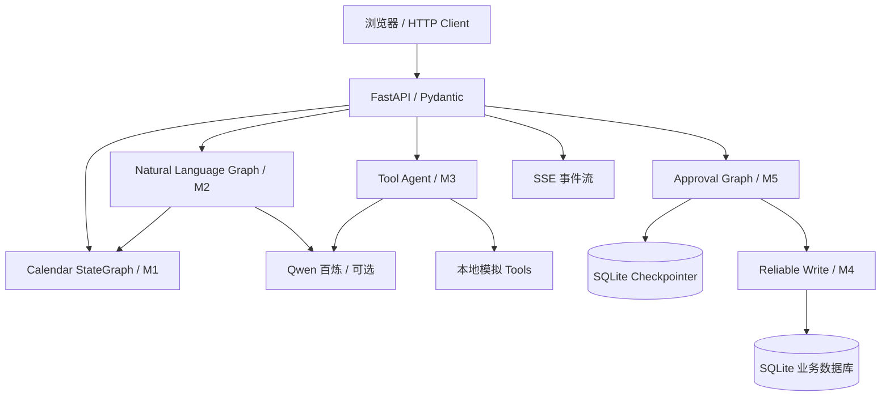

# Personal Productivity Agent（PPA）项目情况说明与 Codex 交接文档

> 2026-11-02 审计补充：用户已将本轮范围扩展为“基线优先的审计与受控工程整理”，覆盖本文第 9 节原只读阶段安排，其他安全约束继续适用。最新证据见 [TASK 01 报告](audits/TASK_01_2026-11-02.md)；本文其余部分保留交接时的历史事实，不能作为最新测试结论。

> 文档版本：2026-11-02 / Handoff v1
> 项目定位：面向 Agent 应用工程实习的**可演示、可测试、可解释**的个人效率助手工程原型。
> 仓库：`Personal-Productivity-Agent`；本地工作目录据此前对话为 `${PROJECT_ROOT}`（请 Codex 核实）。
> 本文用途：将项目规划与技术意图交给 Codex；**本文不是“代码已经通过验收”的证明**。

## 0. 阅读约定：证据与优先级

1. **本地工作树、实际依赖环境与本次测试完整日志**是最高优先级证据，Codex 开始时必须确认；不能用本交接文档覆盖本地真实情况。
2. 本文的源码模块、路径及设计说明依据此前生成的 **M7 完整项目快照（80 文件）**；用户本地仓库可能已有改动、文件增删或环境差异。
3. “实测”只用于已有实际输出；“源码存在”不等于“运行验证通过”；“推测”不等于错误根因。
4. 所有里程碑均在**同一个仓库**持续演进，不另建 M8 项目，也不为教学拆成多个独立仓库。

## 1. 背景、目标、交付边界

### 1.1 背景

用户准备申请偏工程的 LLM/Agent 算法实习。JD 重点包括 Agent 工作流编排、工具执行、任务准确率、失败后重新规划、状态/会话管理、Python 异步后端、数据库一致性及接口工程。此前按 M0～M7 迭代，现由“ChatGPT 讨论设计 + Codex 负责具体实现”接手。

### 1.2 项目目标（本次交接后保持不变）

实现一个**单机、本地演示**的 Personal Productivity Agent，其最小业务链路为：

1. 用户自然语言表达日程/待办需求（可选千问百炼解析）；
2. 使用确定性代码进行时间校验、日程冲突检查和备选时段推荐；
3. Agent 可选择**本地模拟工具**，读取工具结果并继续决策；
4. 创建待办前可暂停，等待明确的人类确认；
5. 写入本地 SQLite 时使用稳定的 `operation_id`、事务及幂等记录，处理提交前失败/提交后响应丢失；
6. HTTP API + SSE 进度；跨进程恢复待审批工作流；浏览器演示；
7. 自动化测试、可重复的评测脚本、清楚的限制说明和可供面试讲解的架构文档。

**不属于 v1 已交付内容**：第三方真实日历/任务/天气/搜索服务、生产多用户鉴权、多租户、PostgreSQL 实际迁移、gRPC Server、真实在线 Agent Benchmark、线上 SLA。`docs/grpc-interface.proto` 是接口草案，不是可运行的 gRPC 服务。

### 1.3 非目标与禁止误述

- **不以“使用尽可能多的框架”为目标**；不为展示概念而堆叠复杂 Multi-Agent。
- 不把 Mock 业务数据说成真实外部服务接入。
- 不把 10/10 离线场景说成千问模型的成功率。
- 不把 SQLite 单机幂等说成跨第三方服务的 Exactly-Once 保证。
- 不把 Uvicorn 启动成功说成 API 与 LangGraph 全链路通过。

## 2. 历史里程碑与代码落点

| 阶段 | 核心能力 | 源码锚点 | 当前状态（截至交接） |
|---|---|---|---|
| M0 | Python 包、Conda/pip、CLI、pytest、CI | `pyproject.toml`, `cli.py`, `.github/workflows/ci.yml` | 源码存在；部分测试通过 |
| M1 | 时间区间判断、`StateGraph`、条件路由、备选时段 | `domain/calendar_rules.py`, `workflows/calendar.py` | 离线业务场景通过；完整图测试待定位 |
| M2 | Qwen 意图解析、Pydantic、澄清分支 | `domain/intent.py`, `workflows/natural_language.py` | 源码和离线测试存在；真实 Qwen 未验收 |
| M3 | `bind_tools` / `ToolNode`、工具执行反馈、调用预算 | `providers/qwen.py`, `tools/productivity.py`, `workflows/tool_agent.py` | 源码存在；实际框架集成测试待定位 |
| M4 | SQLite 事务/幂等、超时对账、有界重试 | `services/task_store.py`, `workflows/reliable_task.py` | 存储与 M7 确定性场景已有通过证据 |
| M5 | Thread、Checkpointer、`interrupt` / `Command(resume=...)` | `workflows/approval_session.py`, `workflows/chat_memory.py` | 源码存在；真实跨进程 Graph 需验证 |
| M6 | FastAPI、AsyncIO、SSE、HTTP API | `api/app.py` | Uvicorn 已成功启动；端点集成仍须验证 |
| M7 | UI、全量验收、CI、Docker、报告 | `static/index.html`, `evaluation.py`, `tests/`, `docs/`, `Dockerfile` | 10/10 离线评测通过；**全量 pytest 未通过** |

> 注意：这里的“模块落点”基于交付快照；若用户本地仓库与快照冲突，必须先 diff，再以实际代码为准。

## 3. 推荐架构与不可破坏的约束



**关键架构原则：**

- **领域层 `domain/`**：时间解析、区间冲突、业务约束等确定性逻辑，不依赖 LLM。
- **编排层 `workflows/`**：管理 State、Node、Edge、工具循环、审批和恢复；优先复用领域层和服务层，而不是复制业务逻辑。
- **服务层 `services/`**：任务写入与幂等事实；Checkpointer 不可取代业务数据库。
- **传输层 `api/`**：HTTP schema、状态码、SSE、生命周期；不重新实现业务规则。
- **工具层 `tools/`**：描述并执行具体动作，默认只读 Mock；所有真实副作用须受业务与审批约束。
- **模型提供方 `providers/`**：隔离 Qwen/OpenAI 兼容调用；模型不可自行绕过参数校验及业务数据库约束。
- **状态与业务数据分离**：`thread_id` 表示 LangGraph 的运行上下文，`operation_id` 表示某一次业务写入；二者都不等于用户身份认证。
- **恢复边界**：`interrupt()` 前不得执行不可逆写入；恢复可能重新执行节点；业务写入靠稳定幂等键而非 Checkpointer 单独保护。

### 3.1 当前两条独立业务路径（不要误认为已经统一）

1. **自然语言/Tool Agent 路径**：Qwen 可选，主要基于本地模拟工具，负责理解/查询/工具选择；它**尚未**成为所有任务写入的唯一统一入口。
2. **可靠任务创建路径**：HTTP 创建任务草稿 → M5 审批中断 → HTTP 决策 → M4 SQLite 幂等写入；这是实际本地写入路径。

如果 Codex 建议把它们统一，必须先给出风险、测试覆盖和增量迁移方案；不应为了“架构整洁”直接大改全部模块。

## 4. 源码目录规划（M7 交付快照）

```text
Personal-Productivity-Agent/
├── .github/workflows/ci.yml
├── .env.example                 # Key、模型/地域、模式开关
├── .gitignore
├── Dockerfile
├── pyproject.toml               # 依赖声明的唯一权威来源
├── requirements.txt             # -e .[dev]
├── README.md
├── RELEASE_NOTES.md
├── docs/
│   ├── API.md, DEMO.md, EVALUATION.md
│   ├── JD_MAPPING.md, SECURITY.md
│   ├── architecture.md, milestones.md, ownership.md
│   ├── grpc-interface.proto     # 仅草案
│   └── history/                 # M2～M6 历史记录
├── reports/
│   ├── m7-offline-evaluation.json
│   └── pytest-*.txt
├── scripts/
│   ├── qwen_smoke.py
│   ├── verify.ps1, verify.sh
│   └── create_github_milestones.sh
├── src/productivity_agent/
│   ├── api/app.py               # 服务入口、路由、生命周期、SSE
│   ├── static/index.html        # 浏览器 UI
│   ├── domain/
│   │   ├── state.py, policy.py, time_utils.py
│   │   ├── calendar_rules.py, intent.py
│   ├── providers/qwen.py
│   ├── services/task_store.py
│   ├── tools/productivity.py, reliable_task.py
│   ├── workflows/
│   │   ├── calendar.py, natural_language.py, tool_agent.py
│   │   ├── reliable_task.py, calendar_replanning.py
│   │   ├── approval_session.py, chat_memory.py
│   ├── evaluation.py
│   ├── cli.py, __main__.py
│   └── demo_*.py
└── tests/
    ├── test_m0_foundation.py ... test_m5_session.py
    ├── test_m6_api.py, test_m6_integration.py
    └── test_m7_http.py, test_m7_offline.py
```

**目录演进策略**：优先修复并复用当前结构；只有有明确职责边界或测试收益时，才增设 `integrations/`、`persistence/` 等目录。禁止为修测试将实际行为全部 Mock 掉，导致端到端能力倒退。

## 5. 现有公开接口（以本地路由为最终准）

| 端点 | 设计用途 |
|---|---|
| `GET /health` | 存活检查 |
| `GET /app` | 浏览器演示页面 |
| `GET /v1/system` | 返回运行模式与限制 |
| `POST /v1/calendar/check` | 确定性日程冲突查询 |
| `POST /v1/calendar/check/stream` | SSE 节点级进度 |
| `POST /v1/calendar/natural-language` | Qwen 结构化意图解析（可选） |
| `GET /v1/tasks` | 读取本地任务列表 |
| `POST /v1/tasks/drafts` | 创建待审批草稿 |
| `GET /v1/tasks/drafts/{thread_id}` | 查询审批状态 |
| `POST /v1/tasks/drafts/{thread_id}/decision` | 批准/拒绝并可靠写入 |
| `POST /v1/agent/ask` | 千问只读 Mock Tool Agent（可选） |
| `POST /v1/agent/stream` | 工具节点进度 SSE（可选） |

`GET /` 与 `GET /favicon.ico` 在既有实现中可能没有路由；浏览器出现 404 **不能直接认定后端失败**。前端正确入口为 `/app`，API 文档为 `/docs`。

## 6. 环境及配置（不要硬编码密钥）

- 目标开发环境：Windows + PyCharm + Conda + pip；推荐 Python 3.12。
- 用户最新终端提示符出现 `(AgentCabinet)`，不能假设 Conda 环境仍叫 `ppa`，以 `sys.executable` 和 `python --version` 为准。
- `pyproject.toml` 为依赖声明权威；核心依赖快照：`langgraph`, `langgraph-checkpoint-sqlite`, `langchain-openai`, `pydantic`, `fastapi`, `uvicorn`, `aiosqlite`, `python-dotenv`；开发依赖 `pytest`, `ruff`, `httpx`。实际已安装版本必须在审计时记录。
- 环境变量名：`DASHSCOPE_API_KEY`, `DASHSCOPE_BASE_URL`, `PPA_MODEL`, `PPA_ENABLE_LIVE_QWEN`, `PPA_API_TOKEN`, `PPA_DATA_DIR`。
- 默认模型配置（源码快照）：`qwen3.7-flash`；**实际模型可用性/价格/地域必须在启用前核实**，不得自动切高价模型。
- 默认**不调用在线百炼**，不得输出、提交、记录 API Key。

## 7. 已知的最新验收事实（用户本地报告，2026-11-02）

| 项目 | 用户观察到的结果 | 严格结论 |
|---|---|---|
| `python -m pytest -q` | `37 passed, 13 warnings, 31 errors in 9.15s` | **全量回归未通过**；缺少 traceback，根因及分布未知 |
| `python -m productivity_agent.evaluation` | `M7 offline acceptance: 10/10 passed`；生成 `reports/m7-offline-evaluation.json` | 确定性离线业务场景通过，**不是**真实 LLM Agent 任务成功率 |
| `python -m uvicorn ... --host 127.0.0.1 --port 8000` | `Application startup complete` | 应用启动完成，不代表 HTTP 功能/检查点/写入链路完整通过 |
| 浏览器 `GET /` | 404；`GET /favicon.ico` 404 | 当前设计下可能正常，应检查 `/app`、`/docs`、`/health` |
| 实际千问 API / Tool Calling | 尚无本地在线验收记录 | **未验证** |
| 浏览器审批全链路 / SSE | 尚无用户提供的真实端到端日志 | **未验证** |

补充历史证据：前一版生成环境仅执行过 **34 项离线 pytest 测试**和 **10/10 业务场景**；该环境无法安装完整框架依赖。用户本地的 `37 passed, 31 errors` 是**更新且更可信的实际全量结果**，不能用历史“34 passed”掩盖 31 errors。

**严禁在没有 pytest traceback 的情况下断言“31 errors 由某个具体模块引起”。** 它们可能存在共同根因，但必须实际分类。

## 8. 当前风险、未知项和审计优先级

**P0：先定位测试错误，而不是重写。**

1. 收集全量 pytest 报错与 `13 warnings` 内容，按**共同根因**归类（安装、API 版本、Fixture / 生命周期、同步/异步、Checkpointer、状态契约、业务逻辑等为待调查维度，**不是已确认根因**）。
2. 区分单元、Fake Graph、真实 LangGraph、HTTP 集成和跨进程恢复测试；检查是否错误集中在若干共享 Fixture。
3. 核对依赖版本、Python 解释器、PyCharm/Conda 与当前 `pyproject.toml` 的一致性。
4. 在不降低测试标准的前提下比较：小修、局部重构、重写三种方案的相对风险和工作量。
5. 检查安全边界：敏感密钥、确认前副作用、幂等键复用、跨线程审批、Token 演示口令和默认只读状态。

**P1：修复后全链路验收。**

- 完整 pytest 为 0 failed / 0 errors；warnings 有归类说明。
- 离线评测 10/10；`/app`、`/docs`、`/health` 可达。
- 测试草稿→查询→拒绝，以及草稿→批准→本地数据库恰好一次写入，覆盖重放/重启。
- SSE 至少存在合约测试和一项实际集成测试；验证节点事件而非伪称逐 Token。
- 千问在线小额 smoke 单独获批后执行，并保存去敏的调用证据。

**P2：可选完善。**

- 真实 API 接入、更系统的 Agent Benchmark、PostgreSQL/gRPC 服务端均属于下一阶段，不是修复 31 errors 的前置条件。

## 9. 下一阶段开发策略与决策门槛

**默认方案：先审计，再选择性修复；不直接重写。**

- **阶段 A（只读审计）**：Codex 读取代码/测试并运行诊断，将 31 errors 聚类，提供文件路径与 traceback；仅输出审计报告，不修改源码。任务单参见 `docs/TASK_01_CODEX_AUDIT.md`。
- **阶段 B（设计裁决）**：ChatGPT 与用户基于审计证据决定最小修复方案；必要时允许局部重构。未经批准不进行大范围重写。
- **阶段 C（Codex 实现）**：一次只处理一组根因；保留原测试，补回归测试，提供 diff 和测试输出；不自动推送、合并或发布。
- **阶段 D（M7 最终验收）**：执行 `docs/ACCEPTANCE_MATRIX.md`，生成可审阅的结果报告，再决定是否标记 Release。

### 不建议从零重写的初始理由

当前确有部分可运行业务与服务，且错误可能源于少数共享接口或初始化问题；但**是否保留架构必须由审计结果支持**。如果发现无法局部修复的系统性设计冲突，再提交具体的重构/重写论证。

## 10. 协作分工与每轮交付格式

| 角色 | 职责 |
|---|---|
| 用户 | 定义业务优先级、接受/拒绝架构方案、批准真实 API 成本和 Git 操作 |
| ChatGPT（规划/审核） | 明确目标、方案与边界、审阅 Codex 的证据及结果、给出下一轮任务范围 |
| Codex（实现/验证） | 读取仓库、运行测试、定位根因、修复/重构、补测试、提供可复核证据与提交建议 |

Codex 每轮输出必须包含：**(1) 结论 (2) 修改文件清单与原因 (3) 实际执行的命令 (4) 测试结果与未测试项 (5) 风险与剩余工作 (6) Git diff/status**。没有运行的测试不得写“通过”；在线模型调用数和费用必须单独列明。

## 11. 常用核验命令（Windows PowerShell）

```powershell
python --version
python -c "import sys; print(sys.executable)"
python -m pip check
python -m pip show langgraph langgraph-checkpoint-sqlite langchain-openai fastapi pytest

git status --short --branch
python -m pytest -q
python -m productivity_agent.evaluation --out reports/m7-offline-evaluation.json

# 服务命令：启动后访问 /app、/docs、/health
python -m uvicorn productivity_agent.api.app:create_app --factory --host 127.0.0.1 --port 8000
```

完整验收要求见 `docs/ACCEPTANCE_MATRIX.md`。阶段 A 的第一项 Codex 任务见 `docs/TASK_01_CODEX_AUDIT.md`。
