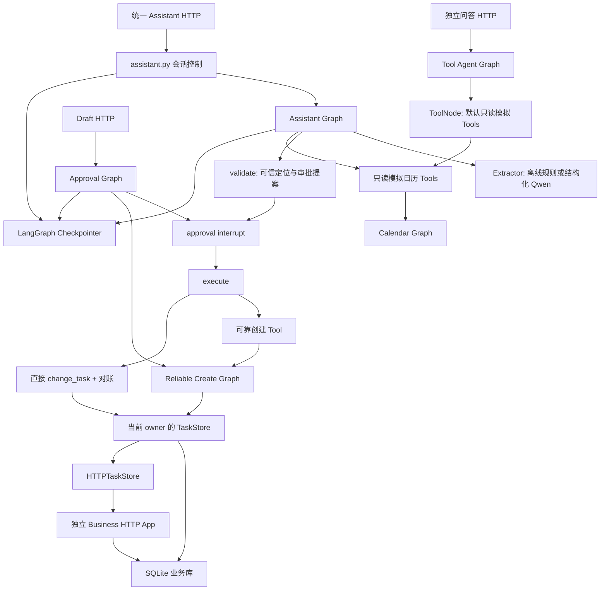
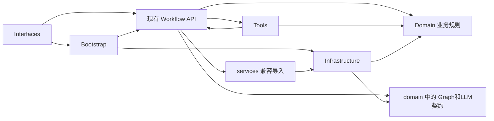
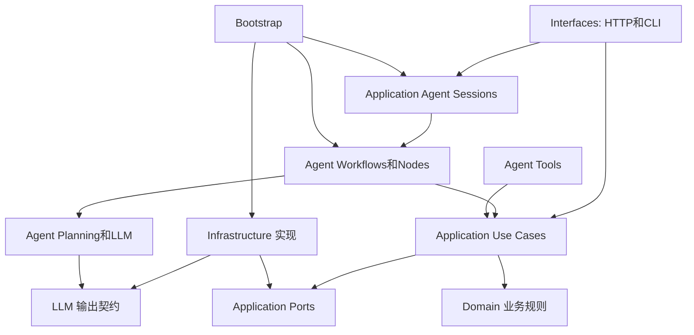

# PPA-R2-A：Application 层只读设计审计

日期：2026-11-03（Asia/Shanghai）。状态：**审计与设计完成，实施待架构审核**。
本报告中的目录、接口和迁移步骤均是建议，不是已实现功能。未开始 R2-B，未修改业务代码，未创建新 PR。

## 1. 合并结果、审计基线与证据口径

用户本轮单独授权 Merge Commit。合并前重新核实 [PR #12](https://github.com/re-tourist/Personal-Productivity-Agent/pull/12)：

- HEAD：`9d063d5cf9457be470a21594c6c53f606294cbdb`；OPEN、MERGEABLE、CLEAN，非 Draft。
- 该 HEAD 的 [Push CI](https://github.com/re-tourist/Personal-Productivity-Agent/actions/runs/41642010824) 和
  [PR CI](https://github.com/re-tourist/Personal-Productivity-Agent/actions/runs/41642019163) 均 completed/success。
- 通过 GitHub Merge API，指定 `merge_method=merge` 和 expected HEAD SHA 合并成功。
- 合并后重新 fetch 的实际 `origin/main`：`40d837c19f42ffd373686c30f4797df2e2598e23`。
- 合并提交的两个父提交分别是 `0ea0a340de5f43d0f234905930ba40c1d88cc62c` 和 `9d063d5cf9457be470a21594c6c53f606294cbdb`。
  与 R1.1 HEAD 的 tree diff 为空，独立提交历史完整保留；R1 远程分支仍存在。
- R2 工作分支：`codex/r2-application-architecture`，直接从上述 origin/main 创建，HEAD 即该合并提交。
- 没有 Squash、Rebase、Force Push、删除分支或 Release；合并以外没有 GitHub 写入。

已阅读 AGENTS、架构原则、当前架构、R1/R1.1 交接；检查全部 8 个实际 Workflow、2 个 Tool 模块、
三类历史状态/意图契约，以及相关 Router、Bootstrap、Store、模型适配和测试。下文源码路径省略
`src/productivity_agent/` 前缀，行号固定于本节基线，不能套用于未来提交。

| 本轮实际执行 | 结果与边界 |
|---|---|
| Python / pip check | 现有 `.venv-py312/Scripts/python.exe`，Python 3.12.8；No broken requirements found |
| `python -m pytest -q` | **158 passed，0 failed / 0 errors / 0 warnings，262.11s** |
| `python -m productivity_agent.evaluation --out reports/r2-a/offline-evaluation.json` | **10/10**，确定性离线场景，不是模型能力评测 |
| 合并提交 CI | [40d837c 的 Push CI](https://github.com/re-tourist/Personal-Productivity-Agent/actions/runs/41645179325) completed/success |
| 源码、测试、脚本及已有文档差异 | 审计前和过程中检查均未修改；最终仅新增本设计报告 |
| 真实模型调用 / 模型费用 | **0 次 / 预估与实际均 0 元** |

完整本地测试日志和 AST 符号/导入清单在被忽略的 `reports/r2-a/`。未读取真实密钥、用户数据库或私人文件。
测试使用既有隔离合成数据；正式 HTTP/子进程测试按现有环境在批准的沙箱外运行。
未额外重跑独立 delivery/compatibility 脚本、Docker、人工浏览器或在线 Qwen；完整 pytest 中的真实
HTTP、ToolNode、认证、并发和跨进程恢复用例已执行。当前通过不等于未来重构已验收。

## 2. 结论：已满足、存在问题、需裁决

### 已满足

外围已完成职责分离，两个 FastAPI App 独立。Domain 业务规则可直接使用；SQLite 的任务/操作索引
共享事务，Checkpointer 与业务事实分离。HTTP 身份、owner 绑定、稳定 operation_id、审批、版本冲突、
超时对账、SSE 和重启恢复有实际测试。R2 应沿这些边界拆分，而非重写主 Graph 或合并演示路径。

### 存在的职责问题

| 优先级 | 证据 | 设计影响 |
|---|---|---|
| P1 | `workflows/assistant.py:53-300`，特别是 `validate:108-203`、`execute:230-275` | Graph、Prompt、历史上下文、任务选择、提案、授权后写入与事实核验集中在一个闭包；没有 LLM 的业务调用难以复用 |
| P1 | `assistant.py:205-228,255-259` → `tools/productivity.py:40-84`、`tools/reliable_task.py:9-34` → Workflow | 内部确定性执行通过 LangChain Tool 再调用 Graph；不是源码循环，却形成不必要的运行时往返 |
| P1 | `workflows/reliable_task.py:9,14-20,60-108` | 业务恢复策略直接识别 SQLite 异常，类型声明为具体 SQLiteTaskStore，实际还接收 HTTPTaskStore；缺少稳定能力契约 |
| P1 | `interfaces/http/routes/assistant.py:42-136`、`drafts.py:47-100` | HTTP 持有 Graph 快照、resume、重放判断、审批状态与会话锁，应用执行控制尚未从协议中抽出 |
| P1 | `bootstrap.py:126-135` 与 `dependencies.py:42-49` | 安全模式依赖每请求创建 owner-bound Store/Graph；迁移为共享 Session Service 时很容易误用未绑定的 app.state 图 |
| P2 | `domain/state.py:7`、`domain/intent.py:14,32`、`domain/agent_intent.py:7` | Graph State、LLM Schema 和意图归一化仍在 Domain 命名空间 |
| P2 | `tools/productivity.py:18-37` | 内存模拟数据实现与 LangChain Tool 定义同文件；模拟任务不是持久业务任务 |
| P2 | `infrastructure/observability/operation_trace.py:9-24` | 通用日志实现知道 intent/target 等特定 Graph State 结构，存在状态形状耦合 |

以上是职责/依赖问题，不是对现有可靠性测试的否定，也不是未经验证的安全漏洞结论。

### 需裁决

优先裁决第 12 节的兼容边界、可靠执行抽取方式与会话控制位置。推荐保留四层模型和双 App，不引入
Repository/UoW、通用 Graph Repository、统一异步 Store 或每个函数一个 Service。

## 3. 当前调用与依赖图

### 3.1 运行调用：三条路径必须区分



- 统一 Assistant 的任务列表/详情/修改/完成使用持久 Store；独立 Tool Agent 的任务列表默认来自内存模拟。
- `build_safe_create_task_tool` 不自带 interrupt 或 approved 检查；当前保护是可信调用方只在批准后调用，
  Web 默认模型工具集中不暴露它。M4 显式 demo/test 是另一条受调用方约束的路径，不能宣称所有 Tool 都内建 HITL。
- 创建经过 M4 有界重试；修改/完成是一次写请求后核验，不会套用创建的重试循环。
- 简单 Task Reads 和 Business App 当前可绕过 LLM；R2 必须继续支持。

### 3.2 源码依赖



图中的 G/T 是目录级聚合：具体为 assistant → Tool factory → calendar/reliable_task Graph，
没有检测到源码模块环；它仍会让通用业务能力依赖 Tool 调用机制。

## 4. 推荐目标组织（仅设计，未创建目录）

```text
application/
├── agent/
│   ├── assistant/
│   │   ├── graph.py          # 原节点名、边和编译；不放 Prompt/业务执行
│   │   ├── state.py          # AssistantState 与持久字段兼容说明
│   │   ├── nodes.py          # 状态补丁、应用结果到会话回复的适配
│   │   └── planning.py       # 意图落地、可信选择、缺参/未来时间校验、审批提案
│   ├── workflows/
│   │   ├── calendar.py
│   │   ├── natural_language.py
│   │   ├── approval_session.py
│   │   ├── reliable_task.py  # 保留旧 Graph 接口/节点；复用可靠执行策略
│   │   ├── tool_agent.py
│   │   └── chat_memory.py    # 原教学 Graph，不冒充新增长期 Memory
│   ├── llm/
│   │   ├── contracts.py      # AgentIntent、ScheduleIntent，保留类名及 Schema
│   │   ├── prompts.py        # 原 Prompt/消息构建，逐字保持
│   │   ├── extraction.py     # invoke、Schema 验证与解析失败边界
│   │   └── normalization.py  # ScheduleIntent 到日程请求的归一化
│   ├── tools/
│   │   ├── productivity.py   # 模型可见只读/显式模拟 Tool 适配
│   │   └── reliable_task.py  # 可信调用方限定的旧写 Tool，调用 Use Case
│   ├── sessions.py           # Assistant/Draft 会话执行，封装 LangGraph API
│   ├── tracing.py            # State 到平面观测字段的映射
│   ├── memory/README.md      # 未来职责说明，无运行实现
│   └── rag/README.md         # 未来职责说明，无运行实现
├── use_cases/
│   ├── tasks.py              # 共享任务读取、授权后的单次业务操作
│   ├── task_execution.py     # 可靠创建、修改/完成后对账与结果核验
│   └── calendar.py           # 日历数据编排与备选提案，不依赖 Tool/Graph
└── ports/
    ├── tasks.py              # TaskReader / TaskStore、记录形状及能力失败契约
    ├── llm.py                # 最小结构化提取能力
    ├── calendar.py           # 当前实际使用的模拟日历读取能力
    └── sessions.py           # thread ownership 能力；不复制整个 Checkpointer API
```

配套变更：`MockProductivityBackend` 归 `infrastructure/integrations/mock_productivity.py`；
模型 SDK/离线解析具体实现仍在 Infrastructure。Domain 保留 contracts、tasks、calendar_rules、policy、time_utils。
Bootstrap 创建 Store、Extractor、Graph、Session 对象并持有 Saver 生命周期。现有 Interfaces 和两个 App 保留。

每个小 Workflow 的局部 State 留在对应 Workflow，不再机械创建一套 states/、nodes/、edges/ 目录。
Assistant 单独拆 State/Graph/Planning 是因为它有实际共享和变化边界。LLM 文件分别承载契约、原文、
解析错误边界和归一化；如果某阶段没有足够内容，应合并相邻同职责文件，不创建占位类。
Use Cases 以少量模块函数或一个内聚的能力集合实现，不要求每个函数建立 Service 类。

## 5. 逐文件、逐核心定义迁移表

表内目标均相对 `application/`；“复用策略”表示节点名和 Graph 状态仍保留，业务算法只保留一个来源。

### 5.1 统一 Assistant

| 当前定义/行号 | 目标 | 职责及兼容约束 |
|---|---|---|
| `assistant.py:19 invalid_numeric_clock` | `agent/assistant/planning.py` | 原始用户文本的有限数字时刻防护；不是通用 ISO 日期领域规则，不扩大正则覆盖范围 |
| `assistant.py:30 AssistantState` | `agent/assistant/state.py` | 原字段/默认缺省行为和序列化值不变；不替换成全新领域实体 |
| `assistant.py:53 build_assistant_graph`，283-300 节点/边 | `agent/assistant/graph.py` | 保留签名兼容入口、6 个节点名、条件路由、Checkpointer 注入 |
| `understand:59-106` 中上下文/Prompt | `agent/llm/prompts.py`、`extraction.py` | history/pending/candidates JSON、模型调用、Schema 验证、parse_failed 边界 |
| `understand:88-106` 中 ID 防臆测、pending 新值合并 | `agent/assistant/planning.py` | 从当前消息或可信 pending 落地选择；不能让模型历史推断获得授权 |
| `understand` 的 State patch | `agent/assistant/nodes.py` | initialize、history、result/approved 清理仍由节点适配，不写 Store |
| `validate:108-203` 的任务定位 | `agent/assistant/planning.py` | 使用共享任务读取能力；保留 1000 上限、候选选择和 Qwen 保守分支 |
| `validate` 的文本/时间缺参、提案与 operation_id | 同上 | 生成待审批的事实快照；operation_id 一次生成并持久，不在 execute/retry 重建 |
| `validate` 的具体任务补丁规则 | `use_cases/tasks.py` 配合 Domain 校验 | 只抽可复用的任务约束；“必须未来时间”仍是 Agent 意图策略，不全局强加给 Business HTTP |
| `read:205-228` | `use_cases/tasks.py` / `calendar.py`；`nodes.py` 映射结果 | 内部直接调用业务能力，不再 `.invoke` LangChain Tool；模拟数据来源和中文回复保留 |
| `execute:230-255` 修改/完成分支 | `use_cases/task_execution.py` | 一次 change、查询 op/current、规范化 UTC、校验 request 与当前事实；不自动重写 |
| `execute:256-275` 创建与二次核验 | 同上 | 调用可靠创建能力并核实返回 Task ID；节点只接收结果并生成回复 |
| `finish:277-282` | `agent/assistant/nodes.py` | 会话回复和历史裁剪；不是长期 Memory 实现 |

### 5.2 其他全部 Workflow

| 当前文件/定义 | 目标 | 处理 |
|---|---|---|
| `calendar.py:19 validate_request` | `agent/workflows/calendar.py` | 保留参数验证、异常消息和 validate_request 节点 |
| `calendar.py:33 reject`、42 `check_conflict` | 同上 | 领域规则仍来自 Domain；保持 invalid/result patch |
| `calendar.py:47 route_after_validation`、51 `route_after_check` | 同上 | 条件边和节点标签不改 |
| `calendar.py:57 mark_available`、66 `suggest_alternative`、82 `build_graph` | 同上 | 保留 SSE 可见节点序列及相同结果；不改成单节点调用以“精简” Graph |
| `calendar_replanning.py:6 propose_calendar_replan` | `use_cases/calendar.py` | 备选提案是可复用业务能力；去除对 Graph 的依赖须先证明所有输入与结果等价 |
| `natural_language.py:16 StructuredExtractor.invoke` | `ports/llm.py`，旧名兼容 | 用泛型提取协议，不强制所有实现继承基类 |
| `natural_language.py:20 NaturalLanguageState`、32 `build_natural_language_graph` | `agent/workflows/natural_language.py` | 保留 State keys 和 Graph 契约 |
| `parse_intent:36-56` | `agent/llm/prompts.py` / `extraction.py` + 原节点适配 | 原 Prompt 和 Schema，失败分类不顺便升级 |
| `route_after_parse:58`、`normalize:61`、`route_after_normalize:70` | 原 Workflow；归一化调用 `agent/llm/normalization.py` | 保留 clarify/unsupported 分支及返回消息 |
| `calendar:75`、`clarify:82`、`unsupported:88`、`parse_failed:94` | 原 Workflow 迁移后位置 | 保留嵌套 Calendar 执行及节点；不改变自然语言接口启用条件 |
| `reliable_task.py:23 ReliableTaskState`、35 `build_reliable_task_graph` | `agent/workflows/reliable_task.py` | Graph 兼容驱动；生产业务算法归 task_execution，不依赖具体 Store |
| `validate:47`、`attempt_create:60`、`reconcile:94`、`retry_gate:113` | `use_cases/task_execution.py` 共享策略 + 原 Graph 节点适配 | 保留计数、错误和 status；故障注入不成为正式 Port 参数 |
| `after_validation:57`、`after_attempt:87`、`after_reconcile:110`、`after_retry_gate:121` | 原 Graph 驱动 | 保留路由，复用同一恢复决策，不能复制两套重试算法 |
| `approval_session.py:18 ApprovalState`、43 `build_approval_graph` | `agent/workflows/approval_session.py` | 保留审批 Graph 与 State |
| `request_task_approval:29` | 同上，作为真实共享审批节点 | interrupt payload 和 `type(decision) is bool` 不变；不能把写入前移 |
| `validate:50`、`after_validation:57`、`approval:60`、`after_approval:65` | 同上 | 原校验和审批状态路径 |
| `execute:68` | 调用 `use_cases/task_execution.py` 的可靠创建入口 | 不再为了普通业务操作构建第二张 Graph；原节点名 execute 和结果字段保留 |
| `tool_agent.py:15 ToolAgentState`、32 `build_tool_agent`、49 `call_model` | `agent/workflows/tool_agent.py` | LangChain/LangGraph 留在 Agent；模型预算、单轮最多 2 个 Tool、重名检查保留 |
| `tool_agent.py:20 SYSTEM_PROMPT` | `agent/llm/prompts.py`，原模块别名 | 逐字迁移，不调 Prompt 或默认工具授权 |
| `chat_memory.py:7 build_chat_memory_graph`、8 `echo` | `agent/workflows/chat_memory.py` | 保留教学入口和 MessagesState reducer；不改作长期 Memory/RAG |
| 两个空 `__init__.py` | 新包标记；旧包保留迁移说明 | 不增加 import-time 装配或全局模型/Store |

### 5.3 Tools、数据契约、Provider 与关联入口

| 当前定义 | 目标/策略 |
|---|---|
| `tools/productivity.py:18 MockProductivityBackend`、`events_on:22`、`create_task:27` | `infrastructure/integrations/mock_productivity.py`；保留事件筛选、内存任务与 mock ID 算法 |
| `build_productivity_tools:40`、`list_calendar_events:49`、`check_calendar_conflict:54`、`list_tasks:69`、可选 `create_task:77` | `agent/tools/productivity.py`；保留 Tool 名/描述/参数/返回编码，业务计算从 Use Case/Domain 获取 |
| `tools/reliable_task.py:9 build_safe_create_task_tool`、18 内部 `create_task` | `agent/tools/reliable_task.py`；可信 operation_id 由闭包捕获，调用可靠创建 Use Case；原 status/operation_id/task/error/mock_only 保留 |
| `domain/state.py:7 CalendarState` | `agent/workflows/calendar.py`；CalendarRequest/TimeSlot/DecisionResult 的主实现仍在 `domain/contracts.py` |
| `domain/intent.py:14 ScheduleIntent`、`domain/agent_intent.py:7 AgentIntent` | `agent/llm/contracts.py`；保留两种不同动作枚举、类名、字段顺序/描述/default/null/extra 规则 |
| `domain/intent.py:32 normalize_schedule_intent` | `agent/llm/normalization.py`；它消费模型输出，是应用归一化，非独立领域契约 |
| `infrastructure/models/offline_intent.py` 的 `number`、`invoke`、`operation_intent`、`parse_operation_time` | 主实现留 Infrastructure，仅改契约导入；不把有限中文规则变成新增通用 NLP |
| `infrastructure/models/qwen.py:build_qwen_model` | 保留 SDK 实现、配置、重试/Token/HTTP 参数；Bootstrap 选择实现 |
| `QwenMeter.structured/bind_tools/_invoke` | 保留 Infrastructure；结构化输出消费新的同名契约，不改变计量、预算和脱敏 |
| `infrastructure/persistence/task_store.py:34 request_fingerprint` | 推荐移入现有 `domain/tasks.py` 作为纯操作指纹规则，算法逐字不变；旧路径重导出，避免 HTTP Adapter 继续依赖 SQLite 模块 |
| `operation_trace.py:traced_node` 的 State 映射 | `agent/tracing.py` 提取平面上下文；Infrastructure 保留 ContextVar、日志输出与 finally reset，可用注入 callable 协作，不必新建庞大 Observer 接口 |
| `bootstrap.py`、`interfaces/cli.py` | 装配/CLI 直接引用新主实现；资源生命周期和入口参数不变 |
| `demo_m2/3/4/5/5_chat.py`、`scripts/validate_qwen_agent.py`、`validate_m8_qwen.py`、既有 tests/helpers | 按 slice 迁移内部导入；旧入口仍测试，不修改 live 授权或用旧在线结果冒充新验收 |
| `evaluation.py`、Domain 业务规则、两个 App 工厂、static/index.html | 保留现有边界；必要时只改导入和依赖注入，不借机变更业务行为 |

## 6. Use Case / Workflow / Tool 的具体职责

### 6.1 通用业务用例不由 Agent 独占

| 应用入口能力 | 输入/输出与职责 | 明确不做 |
|---|---|---|
| 任务列表、详情、操作查询 | 可信 scope 的 TaskReader；limit/任务 ID/operation_id；返回现有任务和操作记录 | 不解析用户文字、不决定 LLM 候选、不把 count 当全库总数 |
| `create_once` / `change_once` | 已通过边界批准的命令 + owner-bound Store；单次事务操作，原 created/replayed/updated/异常 | 不新增客户端重试，不依赖 Graph 或 Thread ID |
| `create_with_reconciliation` | 稳定 operation_id、title/due、既有有界预算；返回 created/recovered/failed/needs_review、事实与诊断 | 不在 timeout 后生成新 operation_id，不把未知结果报成功 |
| `change_and_verify` | 原 target ID/version、批准后的 patch/action、同一 operation_id；一次写后核验 op 与 current | 不盲目重试 PATCH，不以历史回执覆盖当前任务 |
| 日程检查/备选提案 | 日程请求、来源数据/规则，返回 events/decision/proposal | 不创建日程，不隐式批准备选，不接入真实日历 |

普通 Business HTTP App 调用 **once** 能力；Assistant/审批执行调用可靠创建或写后核验能力。
不能把 Business App 也套入可靠重试：否则客户端和服务端出现两套重试，并改变原 HTTP 响应、故障与请求次数。
trivial reads 不必各建一个类；可并入同一 tasks 模块/内聚能力集合，保留明确应用入口即可。

批准命令建议是小型应用数据记录，包含 action、operation_id、所需 title/due 或 target/version/patch。
仅由可信审批恢复或 Business HTTP 的既有显式批准边界构造；LLM 输出不能直接成为批准命令。
这不是新的生产权限凭证；owner 来自可信执行 scope，而不是模型/请求体的 owner_id。
Business App 无须创建 Graph 会话才能写入，独立运行拓扑不变。

### 6.2 Agent 规划与 Workflow

Planning 负责原始文本防护、模型输出落地、缺参追问、候选歧义、当前消息引文约束、审批提案。
它只做必要读取，不执行写入。Workflow 负责执行顺序、State patch、interrupt/resume 和可观察节点。
Use Case 负责已确定业务操作及可信结果，节点负责把这些事实转成原有 reply/history/result。

不能全局统一时间策略：Assistant 与 ScheduleIntent 的“未来时间”校验是意图路径规则；
当前 Store/Business/Draft 基础创建只要求有效带时区时间，并不一律拒绝过去时间。
将前者移动为全局 Domain/Store 条件会改变公开行为。

### 6.3 Tool 是能力适配，不是内部业务总线

Tool 负责模型可见的名称、参数 Schema、描述、编码和允许暴露的能力集合。内部 Workflow 不再通过
LangChain Tool 调自己的业务用例；Tool 与普通 HTTP 均可以消费同一业务能力。
独立 Tool Agent 的 mock task list 仍是 mock，不自动改成持久任务列表；默认不暴露真实写能力。
显式模拟写开关和受可信构造约束的旧可靠写 Tool 保留；新增自主真实写 Tool 不在 R2 范围。

日历 Port 不能只保留 `events_on`：当前展示按事件开始日期过滤，但冲突计算使用 backend.events
中的全部区间。若改成只用当天展示列表，会改变跨日重叠判断。必须保留这两种读取视角并补跨日用例。

## 7. Ports：最小稳定契约与不能虚构的语义

### 7.1 TaskStore：同步、已绑定可信 scope、六个必要方法

以下是契约示意，不是已添加的代码；初期使用 TypedDict/Protocol 和现有 dict，不重建任务实体体系。

```python
class TaskReader(Protocol):
    def list_tasks(self, *, limit: int = 100) -> list[TaskRecord]: ...
    def get_task(self, task_id: str) -> TaskRecord: ...
    def get_operation(self, operation_id: str) -> OperationRecord | None: ...

class TaskStore(TaskReader, Protocol):
    def create_task(self, operation_id: str, title: str, due_at: str) -> WriteResult: ...
    def change_task(self, operation_id: str, task_id: str, expected_version: int,
                    action: str, *, title: str | None = None,
                    due_at: str | None = None) -> WriteResult: ...
    def lookup(self, operation_id: str, title: str, due_at: str) -> TaskRecord | None: ...
```

TaskRecord 保留 id/title/due_at/version/status。OperationRecord 保留当前两个不同形状，不能捏造统一不可变回执：

| 记录 | 真实行为与契约 |
|---|---|
| 创建操作：request_hash + task | `task_operations` 只保留 task_id；lookup/get_operation 返回当前任务值，不是创建时完整不可变快照（`task_store.py:85-102,236-250`） |
| 修改/完成：request + task | `task_changes.result_json` 保存提交时快照；旧操作重放返回旧回执，但不会回滚新版本（179-234） |
| 不存在/不可访问 | get_task 抛既有 KeyError；操作查询返回 None 的现有行为保留，不能反向泄漏其他用户资源是否存在 |

约束：

- 同 owner、同 operation_id、同规范化请求重放不得再次写入；不同 payload 或跨动作复用必须冲突。
- 版本检查仍在事务内，不能提前读取后当作提交时版本保证；重放查询与版本检查的现有顺序不随意调整。
- UTC 规范化、标题 strip、指纹 JSON 编码、owner operation key 算法和 legacy 原始键全部不变。
- 单次写、操作记录与任务数据的事务由实现负责，不增加 UoW 来拆开现有事务。
- 不将 fault_plan/fault、count_tasks、SQLite 连接/事务或 bearer 加入公共生产 Port。
  count_tasks 是现有本地测试/演示附加能力，HTTP Adapter 没有该方法；不为接口对齐新增 HTTP 功能。
- fault_plan 的旧 Graph 参数保留兼容测试接缝，落在真实 SQLite 故障注入装配，不污染正式业务契约；不以 Fake 替代真实集成。
- 保持同步 Port：当前 SQLite/HTTP 均同步。异步 HTTP Router 继续使用 to_thread，Graph 同步节点由原执行机制调度，
  Business 同步端点继续在线程池执行，不为了形式统一引入第二套 async Store。

### 7.2 失败分类与未知提交

| 分类 | 当前来源 | R2 约束 |
|---|---|---|
| 参数/幂等冲突 | ValueError、Domain IdempotencyConflict | 永久失败，不换新键重试 |
| 版本冲突 | Domain VersionConflict | 重新读取并重新审批，不改成覆盖写 |
| 提交前临时失败 | TransientWriteError、部分 SQLite/连接错误 | 只在既有适配器/算法已明确的边界内有界重试 |
| 可能已提交 | AmbiguousCommitError/TimeoutError；HTTP write 5xx/unavailable | 先对账；不能解释为明确失败；修改/完成不盲目重发 |
| 读取/对账不可用 | BusinessUnavailable/连接/SQLite 读取异常 | 不能吞异常并返回 None；不能伪造“无操作”或成功 |

HTTP 当前将所有 409 映射为 VersionConflict，Business HTTP 又把版本/幂等冲突映射成同一个 409。
因此 Port 不能承诺现有远程实现可区分两种详细原因。初期保留实际异常子类型和 HTTP 字符串，
上层按“冲突”安全处理；新增 wire error code 是另一个需要批准的行为变更。

AmbiguousCommitError 的现有 docstring 偏向“已经提交”，但 HTTP 实际含义是“是否提交未知”。
R2 应将语义写清，并把能力失败定义的主归属放到 ports/tasks.py，旧 Infrastructure/services 路径重导出
同一异常类型；不能仅改名并破坏现有 catch/subclass 关系。Domain 的两个业务冲突仍留 Domain。
SQLite OperationalError 的映射需逐调用位置验证，不能把所有 OperationalError 都声称为确定未提交。

还应补充一个失败边界表征：当前 M4 `reconcile` 只捕获幂等冲突、ConnectionError 和 SQLite
OperationalError，HTTP 的 BusinessUnavailable（RuntimeError）可向外传播；统一 Assistant 另有外层
needs_review 捕获，旧 Draft 不同。此处是源码路径判断，本轮没有单独注入读取故障来复现 HTTP 映射；
B0/B2 必须先记录原行为，不能把所有读取异常统一改成 needs_review 而声称错误语义完全兼容。

lookup/get_operation 的 None 只表达当前可信存储中查无可见操作，不是对任意远端“永久未提交”的证明。
现有 local SQLite/loopback Business 的稳定键和事务语义是重试前提；未来最终一致第三方不在此 Port 的现有保证内。
未知写入、失败的授权预检和不可用读取均不能降级成“安全换键重试”。

### 7.3 身份、Extractor、日历与归属能力

| Port/装配边界 | 最小契约 | 重要约束 |
|---|---|---|
| 可信执行 scope | owner_id、是否安全模式；不含可序列化 bearer | 安全模式先绑定 Store/Graph 再执行；owner 不由 State/LLM/request body 选择 |
| Store 绑定工厂 | 留 Bootstrap/依赖装配，复用现有 for_owner | bearer 只保留在当前 HTTP Adapter；不为每次调用增加 owner 参数或全局凭证缓存 |
| 结构化 Extractor | `invoke(messages) -> T 或可验证 Mapping`，消息为现有 role/text tuple | Qwen、离线规则、测试提取器结构兼容；节点/提取适配层继续 Pydantic 验证，不吞 Schema 错误 |
| Tool Calling model | 现有 bind_tools/invoke 能力留 Agent 的模型交互边界 | 无需先创建通用 SDK 镜像 Port 或统一所有 LangChain 消息类型 |
| CalendarReader | events_on(date_iso) 和当前冲突所需全部 busy slots/snapshot | 保留数据来源、顺序和跨日范围；不包含创建日程或内存模拟任务写入 |
| ThreadOwnership | claim(kind, tid, owner)、owns(kind, tid, owner) | 可直接由现有实现结构满足；owner 来自可信 scope，无须加只有一次转发的 Repository 类 |
| Checkpointer | Workflow 使用既有 LangGraph Checkpointer，Bootstrap 管生命周期 | 不抽象为大型通用 Graph CRUD Port；保留 m6-checkpoints.sqlite/原 schema/启动时机 |

`conservative_selectors` 当前由 `getattr(extractor, 'mode', None) == 'qwen'` 决定（assistant.py:57）。
它是安全策略，不能在定义“只有 invoke”的协议时丢失。推荐装配时显式传入同等选择策略，旧 builder
保留 mode 推导兼容；离线/脚本模式不被顺便升级为在线保守模式，也不能给在线模式放宽定位。
`QwenMeter.structured` 的 mode='qwen'（99-110）及 SDK function name/Schema 测试必须保持。

legacy 模式也不能无条件调用 HTTPTaskStore.for_owner('__legacy__')：当前 legacy HTTP 使用匿名基础
Adapter，而绑定 expected_owner 的 Adapter 会要求远端 auth_enabled=True。须保持安全/legacy 两种装配路径，
并保留 Business 降级后拒绝认证请求的 fail-closed 行为。

## 8. HTTP 中残留的应用执行控制如何迁移

推荐 `agent/sessions.py` 中两个内聚的异步会话入口（AssistantSessions、DraftSessions 或同等模块函数）。
它们封装 Graph 调用、快照解释、操作重放、审批和恢复；只接收可信 scope/业务输入，不接收 FastAPI Request。
Interfaces 继续负责 Bearer 验证、HTTP Schema、状态码/detail、SSE 编码/响应头和断流异常边界。

| 当前 Router 逻辑 | 目标责任 |
|---|---|
| assistant graph_for / owned_config / snapshot_for | 会话应用入口检查可用性、scope 归属、构造原 checkpoint key、读取状态 |
| lock_for / turn / last_message_id | 会话执行控制；进程级锁注册表由 Bootstrap 共享，不能每请求新建独立锁字典 |
| create/get/decide/recover 中 ainvoke/aget_state/Command | Application Agent 会话运行层；保持 session 初始化、严格审批及恢复条件 |
| view / _snapshot_response | 应用返回安全的普通会话投影，Interfaces 保留响应映射；不把完整 snapshot 泄漏出去 |
| Draft 创建 operation_id、__interrupt__ 判断与审批锁 | Draft 会话入口；保留三条原 HTTP 端点及响应语义，不新增恢复功能 |
| Calendar/Agent Router 中 astream updates 遍历和最终值提取 | Agent 工作流执行入口生成协议无关的应用事件；HTTP 保留既有 SSE 事件数据格式 |
| middleware / HTTP 错误 / StreamingResponse / SSE 序列化 | 继续留 Interfaces |
| Business once 写和普通任务查询 | 通用任务用例入口，不依赖 Agent Session 或 Checkpointer |

不可抹平的差异：

1. 统一 Assistant 的同一 operation_id、相同已完成审批可返回原视图；旧 Draft 结束后再次审批是 409。
2. last_message_id 只检查最后一条消息及 message 文本，重放返回当前会话视图；不是全历史消息幂等账本，
   也不是按 reference_now/timezone 重新计算请求摘要。不要借重构改成新缓存/账本。
3. pending approval 的 recover 不执行写入；仅非审批的 next 状态才 ainvoke(None)。
4. Stream 的 session 存在性检查在 headers 前；turn 内冲突可能在 headers 后变成 error event。
   将全部预检提前会把原 SSE 200/error 改成 HTTP 409，必须保持原边界。
5. Assistant progress 是 `{node}`；Calendar/独立 Agent progress 是 `{node,status}`。保留各自 JSON 转义、
   default=str 行为、headers、done 唯一且最后、错误不伪造 done；不宣称 Token 流。
6. Async generator 取消/关闭必须释放当前锁并关闭上游流；不承诺已开始的同步工具/HTTP 写可以撤销。

Async 会话入口与同步业务用例分离即可，不需要为了“无框架 Application”再复制一个 GraphRuntime Port。
LangGraph 可以留在 Agent 子系统，通用业务 Use Cases/Ports 和 Domain 不依赖它。

## 9. 依赖方向、生命周期与兼容策略



规则：Domain 业务主实现无外向依赖；Use Cases/Ports 不导入 FastAPI、LangGraph、SQLite、具体 SDK；
Agent 可使用 LangGraph/LangChain；Infrastructure 只引用 Ports/必要 LLM 数据契约，不引用具体 Graph/Node/Router；
Bootstrap 知道具体实现、开关和生命周期。新主实现不从旧 workflows/tools/services/providers/domain 历史契约导入。
数据契约不是凭位置就正确：Graph State、LLM output、HTTP 请求模型不能统一为同一领域实体。

资源约束：

- Store/身份/Checkpointer 三种事实分开，文件名和事务不变；不建立跨库原子性或 exactly-once 的新承诺。
- Saver 仍在 Bootstrap 的 async context 中开关；仅为了转发这几行代码不新增 Checkpointer Factory。
- 会话对象可以每请求绑定，但锁字典必须进程共享；不能把 bearer 放入 State、日志或共享 Graph。
- HTTP 业务进程依然本地 SQLite；Assistant 选择本地/HTTP Adapter。不把 Business 的 Store 配成回调自身的 HTTP 递归链。
- 同步任务查询在异步 HTTP 入口仍在线程中执行；不改 timeout、HTTP client 生命周期或 trust_env 来“优化”。

兼容分层推进：

1. 保留 api.app:create_app、api.task_service:create_task_service、cli:main、python -m productivity_agent、ppa。
2. workflows/tools 原 public builder/helper 原名重导出同一主实现；不得复制算法。内部生产调用逐 slice 转新路径。
   包括既有调用方使用的 imported helper，例如 `workflows.calendar.overlaps`，不能只导出本模块定义的函数。
   `_thread_config`、`_snapshot_response` 等已承诺的旧 Interface 辅助入口也继续验证；
   HTTP 错误映射可以留在 Interface 兼容适配，不让 Application 为保留旧签名而抛 HTTPException。
3. 旧 services/providers/security identity 兼容不因为“目录整理”被扩大为新依赖。
4. 旧 domain/state.py、intent.py、agent_intent.py 若保留别名，会出现历史 namespace → Application 的依赖。
   推荐临时明确白名单这三个兼容壳，同时严格禁止任何 Domain 业务主实现/新代码导入它们；
   保留 canonical Domain 依赖断言、增加精确 facade 结构和同对象断言，而非动态 __getattr__/importlib 隐藏依赖。
   这是一项需要裁决的过渡例外，不能声称整个 domain 命名空间已经零反向依赖。
5. 不重命名节点、State key、thread key、checkpoint namespace、interrupt 顺序和 payload；保留原历史数据。
   Pydantic class 名、字段及 Tool name/description 不变，尤其是 forced function_calling 的 AgentIntent/ScheduleIntent。

## 10. 分业务切片的 R2 实施计划（均待授权）

不是先搬完所有目录再修测试。每个 slice 完成后必须可独立验收；一个 slice 失败，不继续下一项。

| 阶段 | 业务切片和主要工作 | 独立验收 |
|---|---|---|
| R2-B0 | 固定 40d837c：保存 OpenAPI、有序路由、Prompt/Schema/Tool payload、状态/节点名、旧数据夹具；确认兼容白名单与目录裁决 | 当前 158 测试、两 App 启动、合并基线快照，记录不改业务的起点 |
| R2-B1 | **读取与日程检查**：TaskReader/CalendarReader、只读 Use Cases；搬 M1/M2/M3 相关入口和契约/Prompt；分离 mock backend | 非 Agent HTTP 查询/日程、CLI、Calendar SSE，mock 与真实任务不串源；无新增写能力 |
| R2-B2 | **创建→审批→可靠持久化→核验**：TaskStore 写契约、可靠创建策略、Approval Graph、旧可靠 Tool；消除 Workflow→Tool→Graph 内部往返 | 批准/拒绝、提交前失败有界重试、提交后丢响应对账、重放/异 payload 冲突、单条任务及同 ID |
| R2-B3 | **修改/完成→版本冲突→写后核验**：单次操作与 change_and_verify 分开；Business 与 Agent 共享能力但保持执行策略差异 | 三类 HTTP 故障、恰好一次 PATCH、同任务 ID、版本增加、并发一成功一冲突、旧回执不覆盖新状态 |
| R2-B4 | **自然语言→澄清/定位→审批提案**：拆 Assistant State/Graph/Nodes/Planning 和模型调用边界 | 缺时间多轮、同名任务、引文、候选选择、新值保留、Qwen 保守模式、无效数字时间；Scripted/真实 SDK MockTransport，0 在线调用 |
| R2-B5 | **会话生命周期与 SSE**：Assistant/Draft 会话运行入口，移出 Router 的 Graph 控制；保留进程共享锁 | JSON/SSE、错误/断流、Message ID 与审批重放差异、跨用户访问、旧代码到新代码的 Checkpoint 恢复 |
| R2-B6 | **旧入口与架构收束**：迁内部导入、验证兼容壳、状态相关观测边界、Memory/RAG README、文档和包数据 | 依赖/循环检查、全部旧入口、两个 App、全量/离线/真实 HTTP/基线兼容，明确保留或批准删除的壳 |

B2/B3 中 Business App 使用单次能力而非客户端可靠执行器，避免双重重试。B4 不优化 Prompt、不扩大
原规则能力；B5 不改 Graph 的持久身份。所有阶段默认离线、依赖版本不升级、合成测试数据隔离。

### 每阶段通用回归 Gate

- 关联单测/真实 Graph/HTTP 用例 → 全量 pytest → 10 场景离线评测。
- `pip check`、`compileall -q src tests`、修改文件 Ruff、`git diff --check`。
- `scripts.verify_final_delivery` 的真实认证 HTTP 和三进程恢复。
- `scripts.verify_r1_compatibility --baseline 40d837c19f42ffd373686c30f4797df2e2598e23 --out <阶段隔离目录>`。
- 完整 OpenAPI（含 operationId）、路由顺序、静态页面、错误状态/detail、SSE headers/事件序列与最终结果保持。
- 旧测试可以按明确迁移更新导入，但不得删除、跳过、弱化断言或把真实集成替换为 Fake；保留专门的旧导入兼容测试。

现有 compatibility 脚本主要验证旧 Draft 的跨代码版本恢复；不能拿它代替统一 Assistant 的全部恢复验证。
B0/B5 要增加同一 baseline checkout 生成的数据夹具：ready/clarification_required/awaiting_approval、
写后响应丢失与待恢复 next 节点；分别在安全/legacy、本地/HTTP 模式启动新代码恢复，核对 op/Task ID、
owner、版本、批准/拒绝、重复决定、结果和额外写次数。节点改名或 State schema 变化必须触发停止审核，
不得删库重建或用空 Checkpoint 证明恢复。

## 11. 风险、停止条件与验收缺口

| 风险 | 检查/停止条件 |
|---|---|
| 旧 Checkpoint 无法执行 | node/namespace/state key/interrupt payload 改变、旧待审批读不到或重复写入：停止该 slice，保留旧库与 traceback |
| 身份绑定丢失或每请求锁独立 | 任何跨用户任务/会话/operation/SSE 可见性变化，Bearer 落到共享对象，或并发审批变成多次成功：停止 |
| 未知提交被简化为失败 | timeout/5xx 后换键、盲重试、None 吞读取错误、未经证明声称 created：停止 |
| 统一接口抹平旧差异 | Draft 重放改 200、Assistant 重放改 409、Message ID 新摘要、错误时机/SSE 格式变化：停止并报告 |
| 安全策略随着 `.mode` 消失 | 在线候选选择变宽、pending patch 丢失、未批准即写或模型可见真实写工具：停止 |
| 原业务规则被加强/变更 | 全局未来时间、跨日筛选变化、不同UTC指纹、缺省/None/trim 变化：停止；必要的规则修复另开批准任务 |
| 历史目录兼容伪装为干净依赖 | 动态隐藏 import、复制实现、扩大白名单到业务主实现：拒绝该设计 |
| 模型/外部资源成本 | 不执行在线验证、外部服务或模型下载；需要时先单独授权，不能自动升级模型 |

现有测试不是未来重构的充分证明。新增的关键验收是：双 Adapter 的同一 Port 语义矩阵、非 Agent
单次业务调用、跨代码版本的统一 Assistant 恢复、明确的协议/Prompt 快照和旧兼容壳的边界检查。
不趁 R2 新增生产认证、多 Worker、第三方服务、数据库迁移、删除任务、复杂消歧或自动通知。

## 12. 提请用户与 ChatGPT 裁决

| 决策 | 推荐 | 备选与代价 |
|---|---|---|
| D1：旧 domain 导入如何兼容 | 三个明确 legacy facade 暂时白名单；所有新主实现/Domain 业务禁止依赖，末期单独决定删除 | 立即移除可保持严格 namespace，但会破坏旧导入；不能两者兼得却不承认例外 |
| D2：可靠创建算法如何独立于 Graph | 共享无框架执行策略/步骤函数，Graph 与普通业务执行复用；保留旧节点驱动和 fault_plan 测试接缝 | 整张 M4 Graph 留作通用 Use Case 的内部引擎可降低迁移风险，但长期保留通用业务对 LangGraph 的耦合；不建议复制两套算法 |
| D3：HTTP 执行控制放哪里 | Agent 的 sessions.py 封装 LangGraph，会话与 Draft 保留各自方法/重放语义；通用任务 Use Cases 不依赖它 | 建大而通用的 GraphRuntime/CheckpointRepository Port 会镜像框架、增加跳转，目前没有替换需求 |
| D4：模型工具的写权限边界 | 保留 Web 默认无真实写 Tool；旧可靠 Tool 只由可信 caller 构造，Agent 内部改为直接调用批准后的 Use Case | 要强制所有 demo/CLI Tool 都走 HITL 属于额外行为变更，不能在重构中让测试“假批准”来掩盖差异 |
| D5：是否统一 SQLite/HTTP 详细冲突和历史回执 | 本轮保留现有 wire/存储语义，Port 明示差异并安全处理 | 新 error code 或创建时不可变快照需要 API/数据库语义设计，超出兼容重构 |
| D6：目标文件颗粒度 | 采用本报告的小量职责模块，允许相邻同职责合并；Memory/RAG 仅 README | 一节点一文件/一方法一类或先建所有未来 Port 增加形式成本，不推荐 |

推荐批准以上边界后，再逐 slice 下达 R2-B 实施授权。本轮交付只是设计与当前证据；不提交本报告、
不推送 R2 分支、不创建 PR，不开始任何 Application 代码迁移。

## 13. 本轮最终变更和状态

业务代码/测试/脚本/依赖修改：**无**。唯一新增仓库交付物是本设计报告；已有架构/历史文档不改写。
用户原有 `RELEASE_NOTES.md`、`exercises/` 未改动、未清理。测试日志与索引均在忽略目录。
GitHub 唯一写入为明确授权的 PR #12 Merge Commit；其余仅查询。真实 Qwen 调用 0 次，模型费用 0 元。
等待架构审核，不自动进入 R2-B。

## 14. R2-B0 审核决策记录（追加，保留上述 R2-A 原始记录）

用户已批准 D1–D6 的原则，并授权先执行 **R2-B0**。批准不等于允许跳过兼容 Gate，
也不授权提前实施 B1–B6。以下结论取代第 12 节的“待裁决”状态；前文原始审计和验收次数保持原文。

| 决策 | 正式结论及不可省略的前置条件 |
|---|---|
| D1 | 只允许 `domain/state.py`、`domain/intent.py`、`domain/agent_intent.py` 三个旧位置成为临时 Application 兼容 facade。其他 Domain 文件和所有新主实现禁止依赖这些 facade；不扩大白名单，不用动态 import 隐藏依赖，不复制实现。B0 不执行迁移。 |
| D2 | 批准提取可共享的无框架可靠执行步骤，但必须先验证嵌套 Graph、历史 Checkpoint 和跨源码恢复。B0 实测子 Graph 继承父 saver/config，并实际写入子 namespace；因此不能直接删除旧嵌套驱动。后续优先保留 `validate/attempt_create/reconcile/retry_gate`、父 `execute` 和调用位置，内部复用策略；任何改变恢复身份的实现必须停止并提交额外兼容方案。 |
| D3 | Agent Sessions 封装会话控制，**不依赖 FastAPI**。Router 只处理请求/响应、SSE 编码和边界错误；Assistant/Draft 的重放差异和共享进程锁保留。不得创建镜像 LangGraph 的通用伪 Port。 |
| D4 | 模型默认不获得真实持久写权限。旧可靠写 Tool 仅由可信 caller 为一个已授权 operation 构造；普通 HTTP 业务能力独立于 Agent。此阶段不改变既有演示授权语义。 |
| D5 | 保留 SQLite/HTTP 的详细异常、409、创建/修改历史回执差异，不重新设计 wire protocol 或数据库。未知提交和对账读取失败不能解释为未执行；Port 契约必须显式容纳现有异常传播。 |
| D6 | 按职责适度拆分，允许相近模块合并；不创建无实际调用方的 Port/Factory/Service。Memory/RAG 仅在获授权的收束阶段添加职责说明，不实现功能。 |

### 强制的 Checkpoint 迁移契约

- 冻结节点名、边、字段名/类型/缺省、reducers、消息类型/ID、interrupt payload、布尔 resume、
  父/子 namespace、thread key、checkpoint 格式与 serializer 依赖版本；不能只比较最终 JSON。
- Web Assistant/Draft 使用 `m6-checkpoints.sqlite` + AsyncSqliteSaver；M5 Approval 和 Chat Memory
  分别使用 `m5-checkpoints.sqlite`、`m5-chat-checkpoints.sqlite` + SqliteSaver。三者都纳入兼容 Gate。
- Authenticated/legacy 和 SQLite/HTTP 各自保留绑定行为；M5 原 CLI 仅有 legacy，不能声称验证了不存在的认证 CLI。
- 固定 `40d837c19f42ffd373686c30f4797df2e2598e23` 源码生成历史数据，候选源码另进程读取并恢复，
  再由第三进程验证终态。夹具不得由候选源码冒充旧版本生成。
- B0 未改业务源码，故当前验证是固定旧源码到**相同业务实现的候选源码**；它建立未来跨迁移版本的
  可执行 Gate，不证明尚未实施的重构天然兼容。B1–B6 每阶段必须用实际变更后的实现重新运行。
- 网络请求/Store 调用允许在崩溃后重放；operation_id、Task ID、业务任务条数、版本增量和操作索引
  必须保持一次业务效果。不能将“仅一次 HTTP 调用”当作一般恢复保证。
- D2 提取前必须覆盖 Tool 中转及直接嵌套两条真实调用链；保留子 namespace 及失败中间状态，
  不以顶层终态通过来替代子图恢复证据。不能为通过测试而屏蔽 child checkpointer。

执行方法、故障语义、夹具生成命令和阶段停止条件见
[R2-B0 兼容基线](R2_B0_COMPATIBILITY_BASELINE.md)。本次提交范围是文档、测试和验证工具；
Application 代码迁移仍须下一阶段的单独授权。
