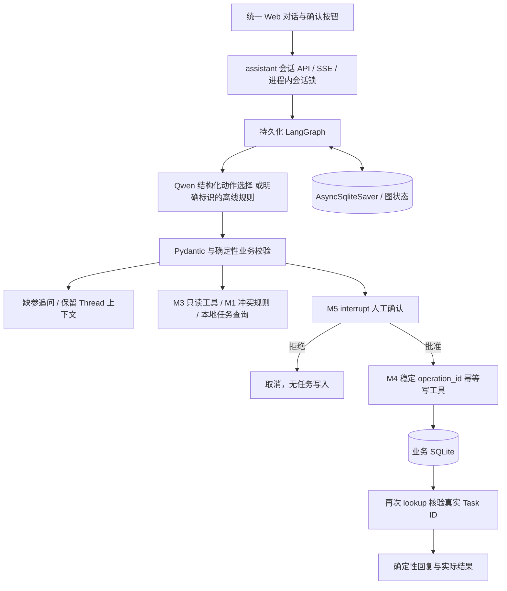

# TASK 04 — Functional Integration & MVP Completion

本轮完成统一 Web Agent MVP。Python 3.12.8 全量 **85 passed / 0 failed / 0 errors / 0 skipped / 0 warnings**，M7 确定性离线评测 **10/10**；本轮新增/修改 Python 文件 Ruff 全部通过，历史全项目 Ruff 剩余 16 项。本轮真实模型调用 **0 次**，预估/实际模型费用 **0 元**。未 stage、commit、push、merge 或 release。

## 1. 真正可用的功能

| 场景 | 实际行为与证据边界 |
|---|---|
| A 创建任务 | 自然语言理解标题/到期时间 → 确认卡片 → 明确批准 → M4 写入 SQLite → 按 operation_id 重新查询核验 → 返回真实 Task ID → 再次查询可见。持久化是真实本地业务操作 |
| B 日程检查 | 查询 M3 本地模拟日历，调用其 M1 冲突工具，返回首个符合规则的备选时间；不创建/修改日程 |
| C 多轮补充 | 缺时间时追问，同 Thread 输入“明天下午三点”继续；浏览器刷新、重建应用及真正跨进程重启均有验证 |
| D 拒绝/异常/重放 | 拒绝零写入；同操作确认重放不重复写；旧 operation_id 无法确认新操作；工具失败/核验失败不宣称成功；不能用普通文本或字符串布尔绕过审批 |
| Web 主入口 | 统一对话、SSE 进度、批准/拒绝、任务查询、新会话、恢复会话；旧模块调试面板折叠保留 |

两种理解模式共用同一个图、相同校验和写入边界：

- `offline_rules`（默认）：有限中文语法，仅支持明确示例、今天/明天/后天、中文/数字整点及半点等；**不是 Qwen**，不具备通用语义理解能力。无法解析时返回明确结果或追问，不伪造模型理解。
- `qwen`（显式启用）：复用现有低成本 provider，以 `with_structured_output(AgentIntent, method='function_calling')` 理解与选择 create_task/check_calendar/list_tasks。每条用户消息最多一次模型解析；不再在主入口叠加另一套开放循环。代码接入完成，**真实在线业务效果待验收**，失败不自动回退到规则模式或切换模型。

“提醒”仅是带到期时间的待办，没有定时器、推送、邮件或主动通知。

## 2. 统一架构与复用边界



- `domain/agent_intent.py`：扩展任务/日程/查询意图 Schema，复用 M2“模型抽取、代码校验”边界；保留旧 ScheduleIntent/API。
- `workflows/assistant.py`：唯一新主流程，节点 understand → validate → read_tools 或 approval → execute → finish。没有通用框架或 Multi-Agent。
- `providers/offline_intent.py`：有限离线语法；线上仍使用原 `providers/qwen.py`，原模型/地域配置不变。
- `workflows/approval_session.py`：将原审批节点中 interrupt/严格 bool 校验提取为共享函数，旧图和统一图共用，旧接口行为通过回归保护。
- 写入通过原 `tools/reliable_task.py`，继承 M4 事务、幂等、提交后对账和有界重试；只在明确批准之后构建和调用，模型没有写工具权限。
- 日程通过原 M3 工具查询模拟日历并调用 M1；list_tasks 读取实际业务库，避免误用 M3 内存模拟任务列表。
- `api/app.py` 在同一 lifespan 管理资源，新旧图共享 saver 连接但统一图 Thread 使用 `assistant:` 前缀，避免旧图状态冲突。

Checkpointer 保存上下文、待确认参数和稳定 operation_id，不代替业务事务。恢复可能从节点开头重执行，所以写入仍依赖幂等操作键；遵循 [LangGraph interrupt 语义](https://docs.langchain.com/oss/python/langgraph/interrupts)。

## 3. API 与安全契约

| 接口 | 用途 |
|---|---|
| POST `/v1/assistant/sessions` | 新建持久化会话 |
| GET `/v1/assistant/sessions/{thread_id}` | 查询结果、对话和待确认参数 |
| POST `.../{thread_id}/messages` | 非流式自然语言业务请求 |
| POST `.../{thread_id}/messages/stream` | 相同主流程的 SSE 进度与完成结果 |
| POST `.../{thread_id}/decision` | 严格 bool + operation_id 确认，安全重放 |
| POST `.../{thread_id}/recover` | 继续中断节点；待审批时不会自动批准 |
| GET `/v1/tasks` | 复用原真实本地任务查询接口 |

消息包含 message、带 offset 的 reference_now、IANA timezone 与 message_id（UUID）。同最后一个 message_id 重放返回现有状态，复用键但换文本返回 409。不是任意历史请求的永久去重日志；新请求 ID 表示新请求。待审批时禁止新文本覆盖参数，使用批准/拒绝按钮完成后再继续。

确认必须匹配当前 operation_id；重复同意/拒绝可以返回既有终态，不能因旧按钮或重复网络请求多写任务。核验失败返回 needs_review，提示先查任务列表，不把响应失败等同于“未写入”。重启中断可使用恢复按钮，以同一操作键继续。

新接口复用原可选 token 依赖，仍是本地单用户演示，不是多租户身份认证。模型/工具错误在边界去敏，不返回内部 exception、API Key 或完整 checkpoint；页面使用 textContent 显示对话，避免把模型文本作为 HTML。历史上下文限最近约 16 条，图 recursion_limit=20，M4 重试预算沿用最多 3 次，没有无限 Agent 循环。

## 4. 测试与浏览器实际验收

| 项目 | 结果 | 证据 |
|---|---|---|
| 修改前完整基线 | 76 passed / exit 0（已包含根路由修复，不是旧的 75） | before.txt（本地审计附件，未随公开源码分发） |
| 新增业务集成 | 9 passed / exit 0 | targeted-final.txt（本地审计附件，未随公开源码分发） |
| 修改后全量 | 85 passed / exit 0，无失败/错误/跳过/警告 | full.txt（本地审计附件，未随公开源码分发） |
| M7 离线评测 | 10/10 / exit 0 | evaluation.json（本地审计附件，未随公开源码分发） |
| pip check | 无冲突 / exit 0 | pip-check.txt（本地审计附件，未随公开源码分发） |
| 本轮 Python Ruff | All checks passed / exit 0 | ruff-changed.txt（本地审计附件，未随公开源码分发） |
| 全项目 Ruff | 16 项历史问题 / exit 1；没有改规则掩盖 | 归类（本地审计附件，未随公开源码分发） |
| 浏览器实际操作 | 创建→缺参→补充→批准→真实 ID→刷新恢复→第二操作拒绝→自然语言查询仍 1 条→日程冲突建议 | [记录](../reports/task04/browser-acceptance.json)、[截图](../reports/task04/mvp-browser.jpg) |

新增测试使用真实 FastAPI、LangGraph、AsyncSqliteSaver 和 SQLite，仅替换模型为 Scripted Extractor；另有默认离线语法的完整路径，以及三个真正 OS 子进程间的多轮/待审批恢复。覆盖错误模型输出、工具写失败、写入成功但 lookup 核验失败、严格审批校验、未知时区、naive 时间、旧确认隔离。原有全部测试保留。

浏览器用 computer-use 技能的浏览器入口实际验收，使用新建 `.pytest_cache` 测试数据库；未操作用户已有数据。截图中的任务为验收合成数据，不是在线 Qwen 结果。临时服务验收后停止，不占用用户 8000 端口。

实际命令（Python 3.12，执行时模型开关为 0，模型 Key 在测试子进程清空）：

```powershell
.venv-py312/Scripts/python.exe -m pytest -q tests/test_task04_assistant.py --tb=short
.venv-py312/Scripts/python.exe -m pytest -q --tb=short
.venv-py312/Scripts/python.exe -m productivity_agent.evaluation --out reports/task04/evaluation.json
.venv-py312/Scripts/python.exe -m pip check
.venv-py312/Scripts/python.exe -m ruff check src/productivity_agent/domain/agent_intent.py src/productivity_agent/providers/offline_intent.py src/productivity_agent/workflows/assistant.py src/productivity_agent/workflows/approval_session.py src/productivity_agent/api/assistant.py src/productivity_agent/api/app.py tests/test_task04_assistant.py tests/helpers/assistant_worker.py
```

完整 HTTP/TCP/子进程测试在工具批准的沙箱外执行，避开既有沙箱 HTTP 限制；不把沙箱绕行等同于产品需求。

## 5. 启动与可直接输入的演示

已验证环境 `.venv-py312` / Python 3.12.8，依赖未升级或新增。若是新环境，按 pyproject 安装 `.[dev]`。

```powershell
# 在项目根目录执行
$env:PPA_ENABLE_LIVE_QWEN = '0'
$env:PPA_DATA_DIR = '.ppa-data/mvp-demo'
.\.venv-py312\Scripts\python.exe -m uvicorn productivity_agent.api.app:create_app --factory --host 127.0.0.1 --port 8000
```

浏览器打开 <http://127.0.0.1:8000/>。保持终端运行；如果配置了演示 token，在页面填入。状态条会明确显示离线规则或 Qwen 模式，不能把离线模式称为 Qwen 已验收。

按下列顺序输入：

1. **“帮我创建一个准备组会的任务”** → 请求补充日期时间。
2. **“明天下午三点”** → 同一会话保留标题，显示待确认操作；点击批准，返回真实 Task ID。
3. **“查看我的任务”** → 读取 SQLite，能找到刚创建的记录。
4. **“明天下午三点提醒我准备组会”** → 新待确认操作；点击拒绝，查询后任务数不增加。
5. **“帮我看看明天下午三点能不能安排一小时组会”** → 默认模拟日历包含启动时“明天 15:30～16:30”的已有组会，应建议 16:30～17:30；不写日历。长时间运行跨日后模拟数据可能不在“明天”，此时依据实际数据返回结果，不伪造冲突。

## 6. 真实 Qwen 验收方案（NOT_RUN）

需用户额外明确批准后才能执行。沿用原低成本模型与现有地域配置，不自动切高价模型，不读取/输出 Key。先确认模型和地域可用性，再进行：创建任务请求→核对 AgentIntent 的动作/标题/相对日期；缺时间→补充；日程检查→选中 check_calendar 并观察模拟工具结果；任务查询→选中 list_tasks；最后在独立测试目录人工批准一次并按真实 Task ID 查库。

每项记录结构化参数、选中动作、工具结果、人工审批、DB 核验、模型/地域、调用数和实际 Token/费用（去敏）。同一图不依赖模型自述来宣称成功。在线验证不接外部业务账户，不做不可逆外部写入。未验证：真实 Qwen NLU/工具选择准确率、在线延迟和 SSE 效果。

## 7. 修改文件、限制和技术债

新增：`domain/agent_intent.py`、`providers/offline_intent.py`、`workflows/assistant.py`、`api/assistant.py`、`tests/test_task04_assistant.py`、`tests/helpers/assistant_worker.py`。修改：`api/app.py` 注册/装配统一入口、`workflows/approval_session.py` 提取共享审批节点、`static/index.html` 主对话界面、根 README 启动说明；本报告与 reports/task04 记录验收。没有修改依赖、业务数据库 schema 或旧接口契约。对被修改的 app.py 做必要导入整理并说明 SSE 安全异常边界，未展开全仓 lint 重构。

未实现：真实定时通知、日历创建/持久化编辑、真实第三方日历、多租户、生产认证、RAG/Multi-Agent、跨节点分布式事务、断流续传、任意自然语言的离线解析。Linux CI/Docker 未新增验收。Qwen 在线效果待批准后验证。

影响后续的技术债：历史 Ruff 16 项；mock 日历重启重建且不持久化；进程内 session lock 随会话增长未回收；多轮上下文有长度边界；跨进程验证为正常退出/恢复，不是掉电或故意强杀；客户端 message_id 仅保护最近请求；动态依赖范围/初始 Git 提交与历史文档去敏仍待处理。旧 ReAct/单模块入口仅为兼容调试保留，新业务应优先扩展统一 graph。

Git 仍无初始提交，全部项目文件为未跟踪状态；不以空 diff 声称无修改。本轮无收费模型调用、无 Git 发布动作、无真实业务数据修改。MVP 本地功能验收完成，到此停止等待审核。
