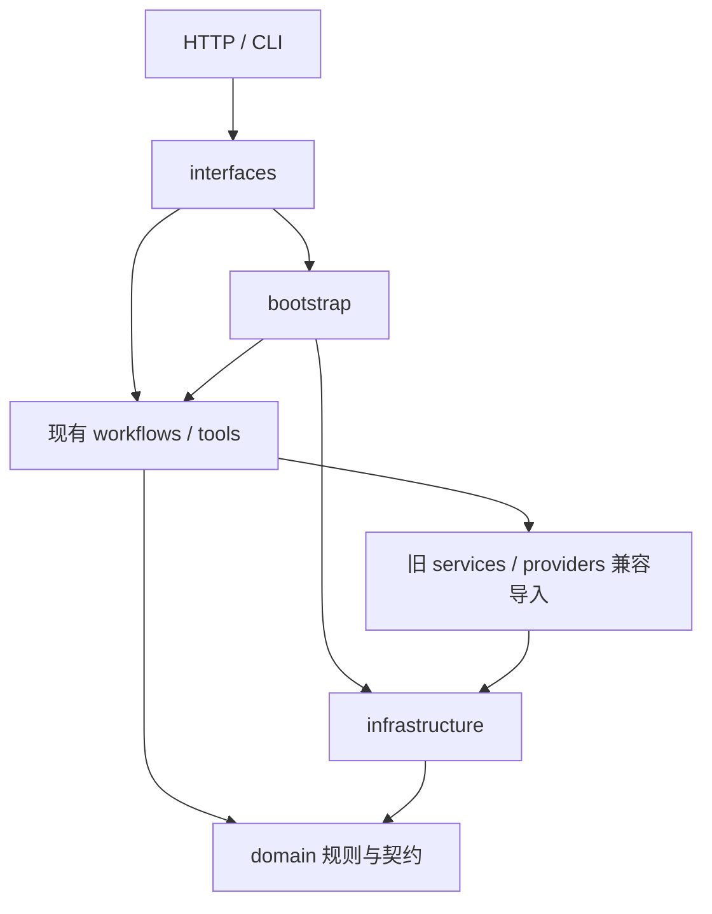

# 架构设计与边界

PPA 是 Python / LangGraph / FastAPI / SQLite 的本地作品集。R1 只拆分 Application 外围职责。
[实施计划](R1_IMPLEMENTATION_PLAN.md) · [R1 验收与 R2 交接](R1_ARCHITECTURE_REFACTOR.md)。

## 当前有效目录

```text
src/productivity_agent/
├── interfaces/
│   ├── cli.py
│   └── http/
│       ├── assistant_app.py, business_app.py  # 两个独立 FastAPI 工厂
│       ├── routes/api.py                     # 原日程、草稿、系统、Tool Agent HTTP
│       ├── routes/assistant.py               # 统一会话 HTTP
│       ├── schemas.py                        # 原 HTTP 请求模型
│       ├── dependencies.py                   # 身份访问、授权、每请求资源绑定
│       ├── middleware.py                     # HTTP 认证与 HTTP 追踪
│       ├── streaming.py, errors.py           # SSE 编码、Business 错误映射
├── domain/
│   ├── contracts.py                          # TimeSlot、CalendarRequest、DecisionResult
│   ├── tasks.py                              # 任务请求校验、版本/幂等冲突
│   ├── calendar_rules.py, policy.py, time_utils.py
│   └── state.py, intent.py, agent_intent.py   # R2 待拆的历史状态/LLM 契约
├── infrastructure/
│   ├── persistence/task_store.py
│   ├── integrations/http_task_store.py
│   ├── models/qwen.py, offline_intent.py
│   ├── security/identity.py
│   └── observability/operation_trace.py, qwen_meter.py
├── bootstrap.py                              # 配置、资源生命周期、Graph 装配
├── workflows/, tools/                        # 现有 Application，R1 冻结
├── api/, services/, providers/, cli.py        # 兼容重导出
├── static/index.html                         # Python 包数据
└── evaluation.py, demo_*.py, __main__.py
```

四层职责模型已确定。Application 主实现目前仍是 workflows/、tools/ 及历史契约；
R1 没有创建未使用的 application/、Ports 或 Memory/RAG 目录，R2 再整体迁移。

## 依赖方向



- Domain 不导入 HTTP、SQLite、模型 SDK、Graph 或 Infrastructure。CalendarState 是待迁出的
  Graph 状态，不是领域实体；ScheduleIntent / AgentIntent 属于 R2 的 Agent 输出契约。
- Infrastructure 不导入 FastAPI、Interfaces 或旧兼容模块。HTTPTaskStore 仍复用持久化模块的
  不确定提交异常和请求指纹，未强行引入新 Port。
- Interfaces 不包含 SQL 事务；路由对 Graph API / Command 的既有依赖暂留，R2 再提取用例。
- Bootstrap 直接引用新 Infrastructure 路径及现有 Graph 构建函数，Graph/SDK 仍延迟导入。
  新实现禁止反向导入 api/、services/、providers/ 和顶层 cli.py。
- 兼容模块只做显式重导出；R2 迁移内部调用后再评估删除，公开启动入口须继续可用。
- tests/test_r1_architecture.py 检查直接/函数内延迟导入、内部模块存在性和循环依赖。

## 资源与身份

Assistant 工厂将生命周期交给 bootstrap.assistant_lifespan：读取原有环境变量，构建
Store、ThreadOwnership、Calendar/Approval/Assistant Graph，在 async context 中持有和关闭
AsyncSqliteSaver。保留默认离线规则与显式测试注入分支，启动不执行模型请求。
Business 工厂通过 bootstrap.business_store 独立创建原 Store，无 Checkpointer；
它仍在工厂调用时初始化业务表，R1 没有改变该时机。

| 文件 | 职责 |
|---|---|
| tasks.sqlite | 任务、操作索引、版本、业务事务与幂等 |
| access.sqlite | thread 与 owner 的持久归属 |
| m6-checkpoints.sqlite | LangGraph 检查点与待审批状态 |

thread_id 是图上下文，operation_id 是业务操作，二者都不是认证主体。超时后须查询操作记录，
不能直接当作写入失败并更换幂等键。数据库 schema、历史迁移、owner 命名空间、事务与指纹不变。
HTTP 模式仍按原顺序初始化本地业务库再选择 HTTPTaskStore，R1 未顺便改变该行为。

账号校验和归属 SQL 在 infrastructure/security/identity.py；Middleware 验证 Bearer 并设置
request identity，legacy 演示口令仍使用 X-PPA-Token。dependencies.resources_for 的缓存仅存在于
当前 request；Bootstrap 按可信身份新建 owner-bound Store/Graph，共享基础 Store 不携带用户 bearer。
安全模式禁止 Business Service 降级后把 Bearer 调用者解释成 legacy owner；
既有未归属数据继续隔离，不自动认领。

## 入口与包数据

| 用途 | 主实现 | 保留入口 |
|---|---|---|
| Assistant HTTP | productivity_agent.interfaces.http.assistant_app:create_app | productivity_agent.api.app:create_app |
| Business HTTP | productivity_agent.interfaces.http.business_app:create_task_service | productivity_agent.api.task_service:create_task_service |
| CLI | productivity_agent.interfaces.cli:main | productivity_agent.cli:main、ppa、python -m productivity_agent |
| 离线评测 | productivity_agent.evaluation | 原模块命令 |

两个 App 各用 Uvicorn --factory --workers 1；旧 Docker CMD、helper 与验证脚本继续使用兼容入口。
静态页面仍位于包根 static/index.html，通过 importlib.resources.files 定位；pyproject.toml 包数据规则不变。
已有 HTTP 路径、方法、Schema、响应、错误映射、SSE 事件和认证方式保持兼容。

## 保持的限制

- 本地单进程 / 单 Worker，会话锁仅在进程内有效；静态测试账号不是生产多租户认证。
- 日程仍采用明确 UTC 偏移的半开区间和同日 cutoff，不新增 DST 能力。
- Mock 日历与 SQLite 任务是不同演示来源；SSE 是节点更新，不是逐 Token 或断线续传。
- 离线评测不是 Qwen 能力评测；真实模型调用需独立授权。
- 不新增第三方服务、生产认证、PostgreSQL、gRPC、RAG 或 Multi-Agent。
