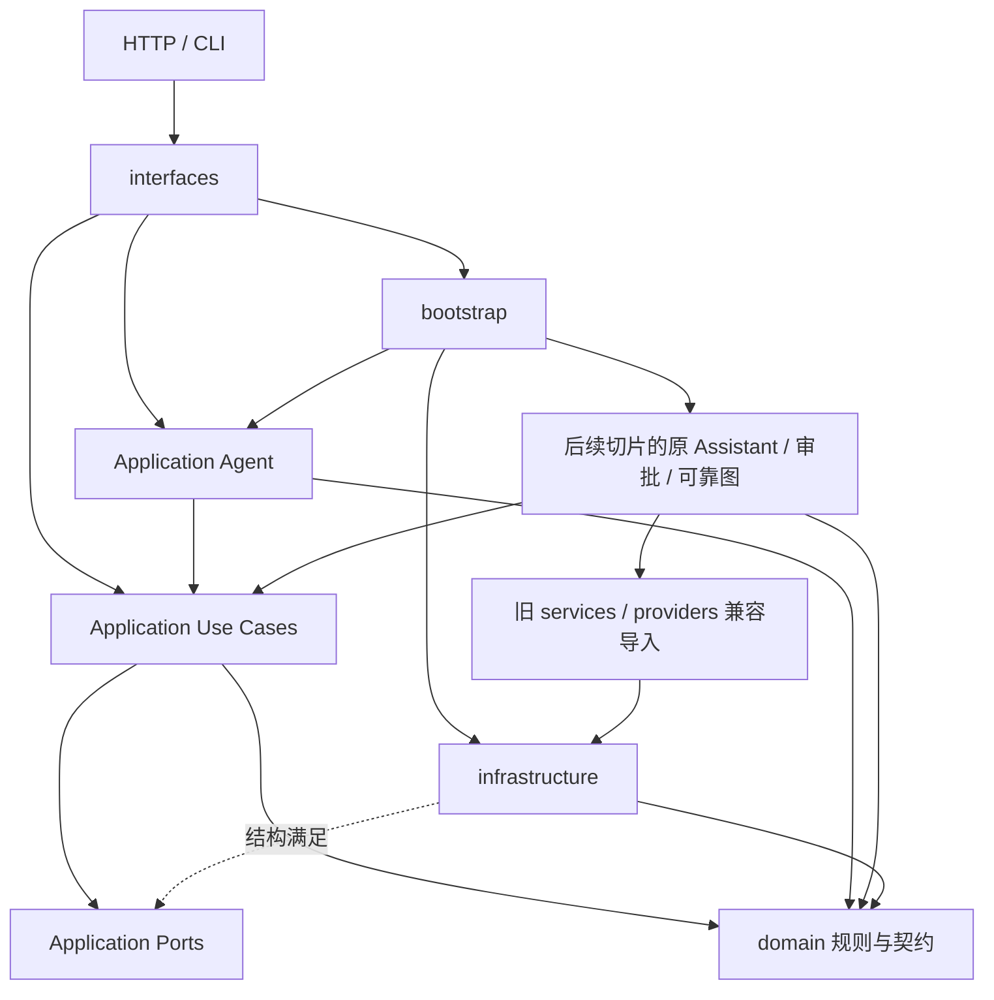

# 架构设计与边界

PPA 是 Python / LangGraph / FastAPI / SQLite 的本地作品集。R1/R1.1 拆分外围职责；R2-B1 建立可复用读取与日程能力。
[长期设计原则](ARCHITECTURE_PRINCIPLES.md) · [R1 原始验收](R1_ARCHITECTURE_REFACTOR.md) · [R1.1 收尾与 R2 交接](R1_1_ARCHITECTURE_CLOSEOUT.md)。

## 当前有效目录

```text
src/productivity_agent/
├── application/
│   ├── ports/                               # TaskReader、CalendarReader、StructuredExtractor
│   ├── use_cases/tasks.py, calendar.py        # 框架无关的读取、日程检查与备选提案
│   └── agent/
│       ├── workflows/calendar.py, natural_language.py, tool_agent.py
│       ├── tools/productivity.py             # 模型 Tool 适配与显式模拟能力契约
│       └── llm/contracts.py, normalization.py, prompts.py
├── interfaces/
│   ├── cli.py
│   └── http/
│       ├── assistant_app.py, business_app.py  # 两个独立 FastAPI 工厂
│       ├── routes/
│       │   ├── api.py                        # 按原顺序组合 Router、兼容草稿辅助函数
│       │   ├── system.py                     # 健康、模式、身份、页面入口
│       │   ├── tasks.py                      # 任务/操作查询
│       │   ├── calendar.py                   # 日程 JSON/SSE
│       │   ├── drafts.py                     # 草稿状态与审批
│       │   ├── agent.py                      # 独立 Agent 问答/SSE
│       │   └── assistant.py                  # 原统一会话 HTTP，未改动
│       ├── schemas.py                        # 原 HTTP 请求模型
│       ├── dependencies.py                   # 身份访问、授权、每请求资源绑定
│       ├── middleware.py                     # HTTP 认证与 HTTP 追踪
│       ├── streaming.py, errors.py           # SSE 编码、Business 错误映射
├── domain/
│   ├── contracts.py                          # TimeSlot、CalendarRequest、DecisionResult
│   ├── tasks.py                              # 任务请求校验、版本/幂等冲突
│   ├── calendar_rules.py, policy.py, time_utils.py
│   ├── state.py, intent.py                   # 已批准的历史兼容 facade
│   └── agent_intent.py                       # Assistant 输出契约，留 B4
├── infrastructure/
│   ├── persistence/task_store.py, thread_ownership.py
│   ├── integrations/http_task_store.py, mock_productivity.py
│   ├── models/qwen.py, offline_intent.py
│   ├── security/accounts.py                  # Identity/Accounts/LEGACY_OWNER
│   ├── security/identity.py                  # 旧导入兼容，无第二份实现
│   └── observability/operation_trace.py, qwen_meter.py
├── bootstrap.py                              # 配置、资源生命周期、Graph 装配
├── workflows/, tools/                        # B1 旧入口 facade + 后续切片的原主实现
├── api/, services/, providers/, cli.py        # 兼容重导出
├── static/index.html                         # Python 包数据
└── evaluation.py, demo_*.py, __main__.py
```

四层职责模型不要求运行时串行经过每一层。TaskReader 的三个同步读取方法由 SQLite/HTTP 的
owner-bound Store 结构满足，不新增 Repository/Service 包装。两个 HTTP App 和 Assistant 列表节点
调用同一读取用例；错误与 None 原样传播，协议状态码映射仍由 Interfaces 负责。
日程用例与阶段函数复用 Domain 区间/备选算法，无 LangGraph/LangChain/FastAPI 依赖。
M1 节点调用这些步骤，同时保留原节点名、State 和 SSE；自然语言与 Tool Agent 的编排留在 Agent。
Mock Backend 归 Infrastructure：CalendarReader 明确区分 events_on 和全量 busy_slots。
模型的模拟任务列表仍读取内存模拟数据，普通任务查询读取真实 Store，不因结构相似而混用。
详见 [B1 的迁移判断与证据](R2_B1_READ_CALENDAR_REFACTOR.md)。未创建 Memory/RAG 或空 Port。

HTTP 业务组使用模块级 APIRouter，仅保留静态路由定义；请求资源始终从 Request 绑定。
api_router() 按 System → Task Reads → Calendar → Draft Approval → Agent 组合，统一 Assistant
Router 在 App 工厂中仍先于这些组注册。Endpoint 名、路径、operationId 和内部执行代码保持一致。
不将原 Endpoint 认证依赖提升到组级，保留公开健康/页面入口及原认证时机。
草稿私有辅助函数归 drafts.py；api.py 保留别名，避免新实现反向依赖聚合入口。

## 依赖方向



- Domain 的业务主实现不导入上层或框架。仅 `state.py`、`intent.py`、`agent_intent.py` 三个历史位置获准
  兼容例外：前两个现已重导出 Application 实现，第三个暂留 Assistant DTO 待 B4；不扩大白名单。
- Infrastructure 不导入 FastAPI、Interfaces 或旧兼容模块。HTTPTaskStore 仍复用持久化模块的
  不确定提交异常和请求指纹，未强行引入新 Port。
- Interfaces 不包含 SQL 事务；任务读取已调用 Use Cases，会话路由的 Graph API / Command 控制留 B5。
- Bootstrap 直接引用新 Infrastructure 路径及现有 Graph 构建函数，Graph/SDK 仍延迟导入。
  新实现禁止反向导入 api/、services/、providers/ 和顶层 cli.py。
- 兼容模块只做显式重导出；R2 迁移内部调用后再评估删除，公开启动入口须继续可用。
- Accounts 不依赖 SQLite，ThreadOwnership 不依赖 HTTP/账号验证；新主实现直接引用最终归属模块，
  不引用旧 security/identity.py。它与 services/identity.py 均导出同一份类型实现。
- tests/test_r1_architecture.py 检查直接/函数内延迟导入、内部模块存在性和循环依赖。
- tests/test_r2_b1_reads.py 增加新 Application 禁止反向依赖、无框架执行、真实源隔离与旧 Calendar
  诊断等值检查。`verify_r2_b1_reads` 从固定旧源码生成嵌套中断，验证读子图和模型消息恢复。

Assistant 的 `read_tools` 节点已取消 LangChain Tool 中转，但在原调用位置保留 Calendar Graph 驱动。
M3 Tool 也保留其 Calendar 子图驱动：同步/异步 Saver 实测均会继承父配置并写子 namespace。
这些驱动负责执行/恢复，业务计算来自框架无关用例。不能为了消除目录依赖而删除历史子 Checkpoint。
Assistant 写入/审批/意图规划、M4/M5 可靠执行及会话生命周期尚未重构。

## 资源与身份

Assistant 工厂将生命周期交给 bootstrap.assistant_lifespan：读取原有环境变量，构建
Store、ThreadOwnership、Calendar/Approval/Assistant Graph，在 async context 中持有和关闭
AsyncSqliteSaver。保留默认离线规则与显式测试注入分支，启动不执行模型请求。
Business 工厂通过 bootstrap.business_store 独立创建原 Store，无 Checkpointer；
它仍在工厂调用时初始化业务表，R1 没有改变该时机。

| 文件 | 职责 |
|---|---|
| tasks.sqlite | 任务、操作索引、版本、业务事务与幂等 |
| access.sqlite | thread 与 owner 的持久归属 |
| m6-checkpoints.sqlite | LangGraph 检查点与待审批状态 |

thread_id 是图上下文，operation_id 是业务操作，二者都不是认证主体。超时后须查询操作记录，
不能直接当作写入失败并更换幂等键。数据库 schema、历史迁移、owner 命名空间、事务与指纹不变。
HTTP 模式仍按原顺序初始化本地业务库再选择 HTTPTaskStore，R1 未顺便改变该行为。

账号校验在 infrastructure/security/accounts.py，归属 SQL 在 persistence/thread_ownership.py；
两者不相互依赖，Bootstrap 将它们装配到进程状态。Middleware 验证 Bearer 并设置
request identity，legacy 演示口令仍使用 X-PPA-Token。dependencies.resources_for 的缓存仅存在于
当前 request；Bootstrap 按可信身份新建 owner-bound Store/Graph，共享基础 Store 不携带用户 bearer。
安全模式禁止 Business Service 降级后把 Bearer 调用者解释成 legacy owner；
既有未归属数据继续隔离，不自动认领。

## 入口与包数据

| 用途 | 主实现 | 保留入口 |
|---|---|---|
| Assistant HTTP | productivity_agent.interfaces.http.assistant_app:create_app | productivity_agent.api.app:create_app |
| Business HTTP | productivity_agent.interfaces.http.business_app:create_task_service | productivity_agent.api.task_service:create_task_service |
| CLI | productivity_agent.interfaces.cli:main | productivity_agent.cli:main、ppa、python -m productivity_agent |
| 离线评测 | productivity_agent.evaluation | 原模块命令 |

两个 App 各用 Uvicorn --factory --workers 1；旧 Docker CMD、helper 与验证脚本继续使用兼容入口。
静态页面仍位于包根 static/index.html，通过 importlib.resources.files 定位；pyproject.toml 包数据规则不变。
已有 HTTP 路径、方法、Schema、响应、错误映射、SSE 事件和认证方式保持兼容。

## 保持的限制

- 本地单进程 / 单 Worker，会话锁仅在进程内有效；静态测试账号不是生产多租户认证。
- 日程仍采用明确 UTC 偏移的半开区间和同日 cutoff，不新增 DST 能力。
- Mock 日历与 SQLite 任务是不同演示来源；SSE 是节点更新，不是逐 Token 或断线续传。
- 离线评测不是 Qwen 能力评测；真实模型调用需独立授权。
- 不新增第三方服务、生产认证、PostgreSQL、gRPC、RAG 或 Multi-Agent。
